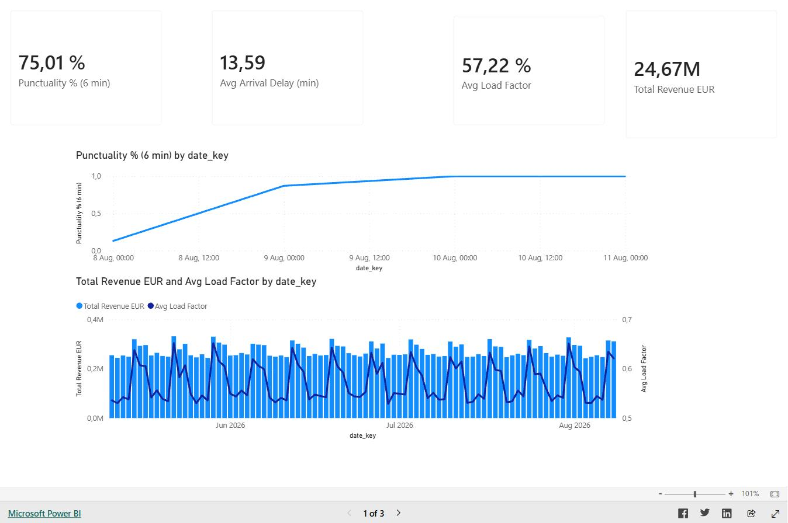
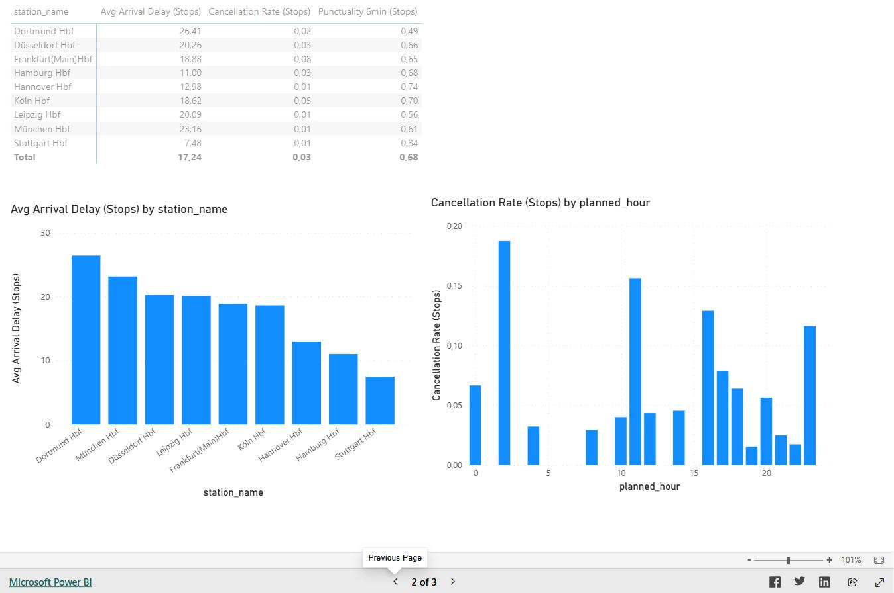
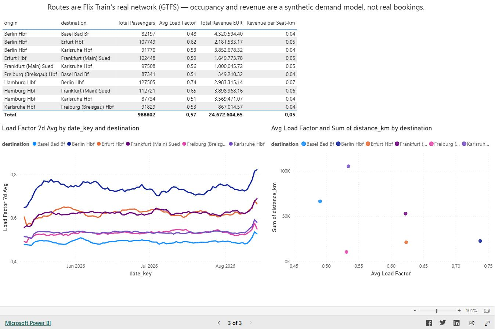

# Case Study: Rail Ops Analytics

**A production-style analytics platform for long-distance rail operations, built to mirror the day-to-day work of an operations data analyst at a rail operator.**

[Live dashboard](https://app.powerbi.com/view?r=eyJrIjoiYzQ2NzcwYzEtMWY3MC00MTcxLTg5MjEtMWUxZjc0ZDNiYjQzIiwidCI6IjRkNzEwMDY2LTQwMjAtNDJjNC04Y2JmLTM4YjhhZDJmYTM1ZiJ9) · [Repo](https://github.com/dreamscaatcher/Flixtrain-analytics)

## The problem

Rail operators steer on two things at once: is the network running on time, and is it making money. Those questions live in different systems — a delay feed and a booking system — and most public rail data only gives you the first half. I wanted to build the full picture anyway, without faking the part I didn't have.

## What I built

A layered ELT pipeline: Python ingests real Deutsche Bahn Timetables data (arrivals, departures, delays, cancellations, platform changes at 10 major hubs) alongside real FlixTrain route geometry (from their official GTFS feed), lands both in BigQuery, and models them through `raw → staging → marts` into a documented star schema. KPI views in the marts layer are the single source of truth — punctuality, cancellation rate, load factor, revenue per seat-km are all computed once in SQL; Power BI only aggregates. A 3-page report (executive overview, operations deep-dive, commercial view) sits on top, published with a public link.

## The honesty problem, solved explicitly

No public rail API exposes booking or revenue data. Rather than quietly inventing numbers, I built a separate, documented synthetic demand model — seeded, deterministic, with realistic weekday/weekend and peak-hour patterns — and flagged it `is_synthetic` end to end: in the table schema, the data dictionary, and a banner on the dashboard's commercial page. But the routes underneath that synthetic demand are real: I pulled FlixTrain's actual GTFS feed and discovered their live network is a single corridor (Hamburg–Berlin–Erfurt–Frankfurt–Karlsruhe–Freiburg–Basel) with two other published lines currently running zero trips — a real finding about the business, not a data gap. The synthetic layer models demand on real, bookable segments of that corridor instead of invented city pairs.

## A bug I found and fixed

Early in the build, `fact_train_runs` tried to enrich synthetic bookings with real delay data by joining on `(train_number, service_date)`. It looked fine in the SQL. It shipped zero matches: synthetic train numbers are always `1200`–`1209` (reset daily), while real DB train numbers use each operator's own scheme (ICE 857, RE 11441) — two unrelated ID spaces with no legitimate join key between them. I verified it (0 of 3,600 rows ever matched), removed the column rather than ship a silently-always-NULL field, and documented why in both the SQL comments and the data dictionary. The fix was smaller than the discipline it took to notice a "successful" join was structurally meaningless and pull it out anyway.

## Other decisions worth naming

**Mid-build warehouse migration.** Started on Snowflake, moved the whole project to BigQuery's free sandbox tier partway through — reran the loader, ported every SQL model to GoogleSQL, added a `sqlglot`-based dialect lint to CI so a bad model fails on push instead of in the warehouse.

**Offline-first testing.** Bundled XML fixtures replicate the real DB API's format, so the full pipeline and test suite run with zero credentials (`--local-only`). Every SQL model is parse-checked as BigQuery syntax in CI.

**Idempotent by default.** `CREATE OR REPLACE` models. Commercial loads replace the table. Stop-event history is appended so each refresh keeps prior service dates. The scheduled job re-runs safely with no manual cleanup.

**Ratio-of-sums, not average-of-ratios.** Revenue per seat-km is aggregated as `SUM(revenue) / SUM(seat_km)` in the route-level view, not averaged per-run, to avoid Simpson's-paradox distortion across routes of different length and volume.

## Stack

Python (ingestion) · Google BigQuery (warehouse) · SQL (star schema + KPI views) · Power BI (dashboard, DAX measures) · GitHub Actions (CI: tests + SQL dialect lint on push, warehouse refresh every 3 hours) · pytest.

## Screenshots

| Executive Overview | Operations Deep-Dive | Commercial |
|---|---|---|
|  |  |  |

## Limitations, stated plainly

Punctuality is a 10-hub proxy, not full-network. Delay is inferred from "changed" events (unchanged is assumed on-time) since the source API reports changes, not confirmations. Commercial figures are a demand model, not bookings — clearly and consistently labelled everywhere they appear.
