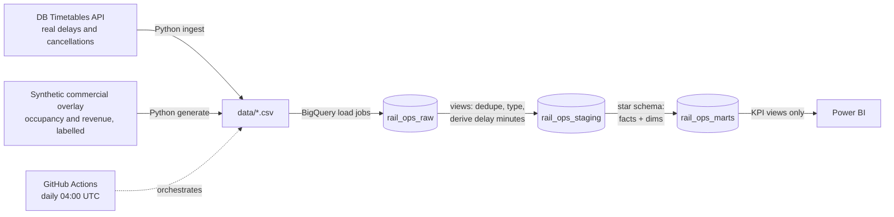

# Rail Ops Analytics

End-to-end analytics platform for long-distance rail operations in Germany: a Python pipeline ingests **real Deutsche Bahn open timetable/delay data**, lands it in **Google BigQuery**, models it into a documented **star schema** with **KPI views as the single source of truth**, and serves a **Power BI** dashboard for operations and commercial steering.

Built to mirror the day-to-day work of an operations data analyst at a rail operator: punctuality, cancellations, station bottlenecks, load factor, and revenue per seat-km — from raw API to executive dashboard.

## Architecture



Layered ELT: `rail_ops_raw` (landed as-is) → `rail_ops_staging` (typed, deduplicated, derived columns computed once) → `rail_ops_marts` (star schema + KPI views). BI tools read **only** from marts — no KPI logic ever lives in a dashboard.

## Data honesty

Two data classes, never mixed silently:

| Layer | Source | Real? |
|---|---|---|
| Timetables, delays, cancellations, platforms | [DB API Marketplace — Timetables](https://developers.deutschebahn.com) | **Real** |
| Occupancy, ticket prices, revenue | `pipeline/ingest/synthetic.py` (seeded demand model) | **Synthetic**, flagged `is_synthetic` end-to-end |

Rail operators do not publish booking data. Rather than fake it quietly, the commercial layer is generated by a documented, deterministic demand model (weekday/weekend patterns, Friday peaks, dynamic-pricing-style yield) and labelled synthetic in every table, view, and dashboard page.

## Quickstart

```bash
git clone <repo> && cd rail-ops-analytics
python -m venv venv && source venv/bin/activate   # Windows: venv\Scripts\activate
pip install -r requirements.txt
cp .env.example .env                              # add credentials (both optional)

# Runs end-to-end WITHOUT any credentials (bundled fixtures, no warehouse):
python -m pipeline.run_pipeline --local-only
pytest -v

# Full run (DB API keys -> live data; GCP project -> warehouse build):
gcloud auth application-default login
python -m pipeline.run_pipeline
```

- **DB API keys** (free): developers.deutschebahn.com → create application → subscribe to *Timetables*.
- **BigQuery** (free sandbox, no credit card, never expires): console.cloud.google.com → new project → set `GCP_PROJECT_ID` in `.env`. The pipeline creates all datasets and objects itself — `sql/00_setup/setup.sql`. Free tier covers this workload comfortably (10 GB storage / 1 TB query per month; this project uses a fraction of both).

Then build the dashboard: `powerbi/DASHBOARD_SPEC.md` (~1–2h in Power BI Desktop, measures provided in `powerbi/measures.dax`).

## Repo layout

```
pipeline/            Python: ingest (API + synthetic), BigQuery bulk loader, runner
sql/                 Warehouse models, executed in order: 00_setup / 10_raw / 20_staging / 30_marts
tests/               pytest suite + realistic API fixtures (offline mode) + SQL dialect lint
powerbi/             Dashboard build spec + DAX measures
docs/                KPI definitions, data dictionary
.github/workflows/   CI: tests on push; scheduled daily warehouse refresh
```

## Key design decisions

- **Derived logic lives in SQL, once.** Delay minutes, punctuality flags, load factor, revenue/seat-km are computed in staging/marts — DAX measures only aggregate. One definition, every consumer agrees.
- **Documented grain on every fact table.** `fact_stop_events`: train × station × event. `fact_train_runs`: train × route × service date.
- **Idempotent everywhere.** `CREATE OR REPLACE` models, truncating load jobs — the daily job re-runs safely with no manual cleanup.
- **Offline-first testing.** Bundled XML fixtures replicate the API's real format, and every SQL model is parse-checked as BigQuery syntax in CI (`tests/test_sql_dialect.py`) — no external credentials or uptime needed to catch regressions.
- **Raw stays raw.** Booleans land as strings and are cast once in staging; a malformed source value fails visibly in one place, and reprocessing from landed data is always possible.

## KPIs

Punctuality (6/15 min, DB-standard thresholds), average arrival delay, cancellation rate, platform-change rate, load factor, revenue per seat-km, and an executive daily rollup. Full business definitions with formulas: [`docs/kpi_definitions.md`](docs/kpi_definitions.md).
